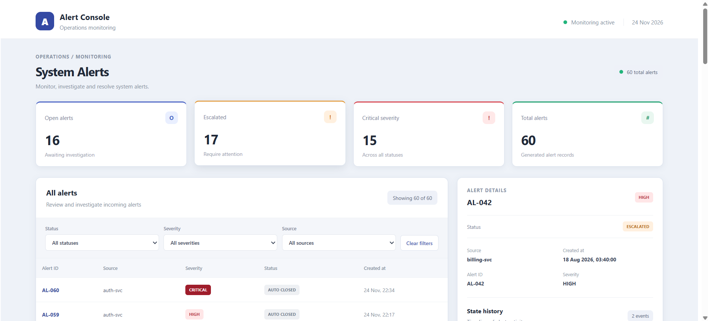
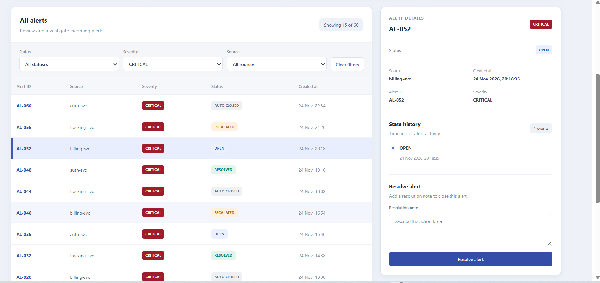
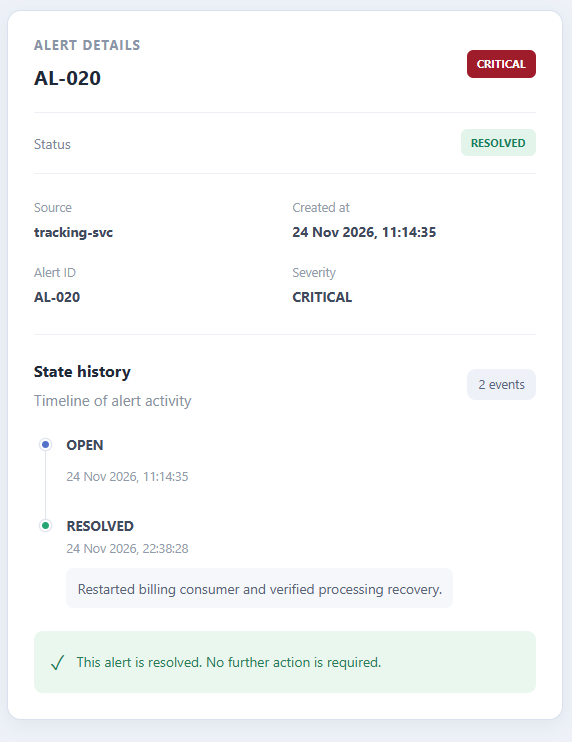

# MoveInSync – Alert Console

An interactive alert management dashboard developed using **Angular 22** as part of the MoveInSync UI Developer case study.

The application enables users to monitor alerts, filter them by multiple criteria, inspect alert history, and resolve eligible alerts with mandatory resolution notes.

## Application Screenshots

## Features

### 1. Alert Dashboard



### 2. Alert Details and State History



### 3. Resolved Alert



- Generates 60 mock alerts at application startup.
- Supports four severity levels: LOW, MEDIUM, HIGH, CRITICAL.
- Supports four statuses: OPEN, ESCALATED, AUTO_CLOSED, RESOLVED.
- Supports three alert sources: tracking-svc, billing-svc, auth-svc.
- Displays severity-based colour indicators.
- Sorts alerts by creation date, newest first.
- Provides three combinable filters:
  - Status
  - Severity
  - Source
- Displays live filtered result count.
- Includes clear filters and empty-state handling.
- Displays selected alert metadata and chronological state history.
- Allows resolution of OPEN and ESCALATED alerts.
- Requires a valid, non-empty resolution note.
- Simulates asynchronous saving with an 800ms delay.
- Updates alert status and appends resolution history after successful resolution.

## Technology Stack

| Technology      | Usage                             |
| --------------- | --------------------------------- |
| Angular 22      | Frontend framework                |
| TypeScript      | Application logic and type safety |
| Angular Signals | Reactive state management         |
| Reactive Forms  | Resolution form validation        |
| HTML            | Application structure             |
| SCSS            | Styling and responsive layout     |

## Project Structure

```text
src/
└── app/
    ├── models/
    │   └── alert.model.ts
    ├── services/
    │   └── alert.service.ts
    ├── app.ts
    ├── app.html
    └── app.scss
```

## Implementation Highlights

- **State management:** Uses Angular Signals to manage alert data reactively.
- **Derived state:** Uses computed Signals for filtered alerts, selected alert details, and dashboard metrics.
- **Separation of concerns:** Alert data generation and updates are managed through an injectable service.
- **Filtering:** Applies AND-based filtering across status, severity, and source.
- **Form validation:** Uses Angular Reactive Forms to prevent empty and whitespace-only resolution notes.
- **Asynchronous updates:** Simulates a backend save operation and updates the corresponding alert using immutable state updates.

## Getting Started

### Prerequisites

- Node.js
- npm
- Angular CLI

### Installation

Clone the repository:

```bash
git clone https://github.com/YOUR-USERNAME/moveinsync-alert-console.git
```

Navigate to the project directory:

```bash
cd moveinsync-alert-console
```

Install dependencies:

```bash
npm install
```

### Development Server

Start the application:

```bash
ng serve
```

Open your browser at:

`http://localhost:4200/`

### Production Build

```bash
ng build
```

The production build artifacts are generated inside the `dist/` directory.

## Assignment Details

- **Organization:** MoveInSync
- **Role:** UI Developer
- **Assignment:** Alert Console – Filterable Table with Detail Panel
- **Framework Requirement:** Angular

## Note

This project uses mock alert data and a simulated asynchronous save operation. No backend or authentication is required for this assignmen

# MoveinsyncAlertConsole

This project was generated using [Angular CLI](https://github.com/angular/angular-cli) version 22.0.6.

## Development server

To start a local development server, run:

```bash
ng serve
```

Once the server is running, open your browser and navigate to `http://localhost:4200/`. The application will automatically reload whenever you modify any of the source files.

## Code scaffolding

Angular CLI includes powerful code scaffolding tools. To generate a new component, run:

```bash
ng generate component component-name
```

For a complete list of available schematics (such as `components`, `directives`, or `pipes`), run:

```bash
ng generate --help
```

## Building

To build the project run:

```bash
ng build
```

This will compile your project and store the build artifacts in the `dist/` directory. By default, the production build optimizes your application for performance and speed.

## Running unit tests

To execute unit tests with the [Vitest](https://vitest.dev/) test runner, use the following command:

```bash
ng test
```

## Running end-to-end tests

For end-to-end (e2e) testing, run:

```bash
ng e2e
```

Angular CLI does not come with an end-to-end testing framework by default. You can choose one that suits your needs.

## Additional Resources

For more information on using the Angular CLI, including detailed command references, visit the [Angular CLI Overview and Command Reference](https://angular.dev/tools/cli) page.
